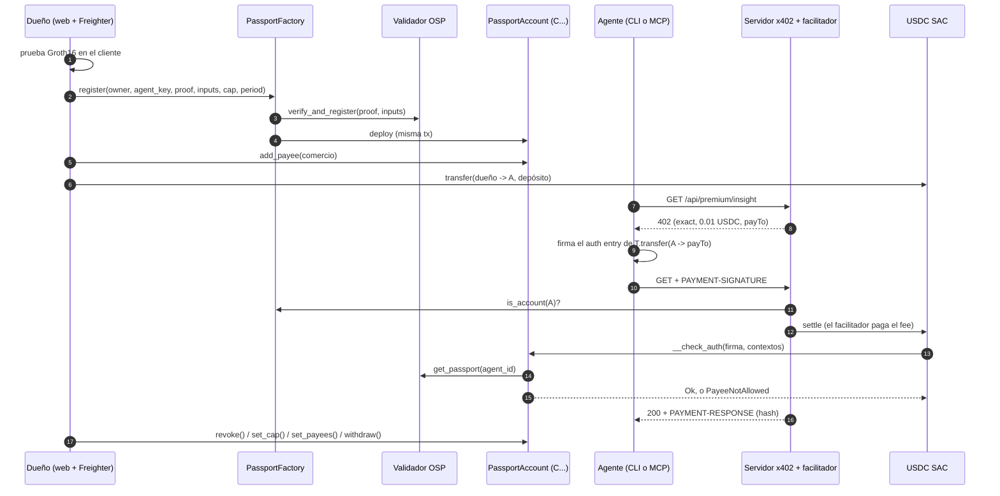

# Passport Pay

**Dale plata a tu agente. No el poder de vaciarla.**

Passport Pay es una API paga para agentes de IA en Stellar donde las reglas de gasto viven en la
cuenta inteligente del propio agente, no en el agente ni en un backend. Los agentes pagan por
request con [x402](https://www.x402.org/) en USDC (la SAC de Circle) sobre `stellar:testnet`.
Cada agente paga desde su propio contrato `PassportAccount`, y su `__check_auth` aplica cuatro
reglas en cada transferencia: un pasaporte ZK vigente, una lista de destinos permitidos que
administra el dueño, un tope por período y la revocación del dueño. A un agente con prompt
injection le pueden hacer firmar un pago al atacante. La red lo rechaza igual.

HackMeridian Genesis · Tracks **Stellar Unlocked** (principal) y **Stellar Composed** · Solo testnet de Stellar, sin plata real.

- App en vivo: https://passport-pay-stellar.vercel.app (la demo está en `/app`, el deck en `/presentacion`)
- Video de la demo (2:23): https://passport-pay-stellar.vercel.app/video
- Código: https://github.com/LucasCariddi/passport-pay
- Arquitectura y todas las interfaces: [`docs/ARCHITECTURE.md`](docs/ARCHITECTURE.md)
- Cómo usamos IA: [`docs/AI.md`](docs/AI.md)
- In English: [`README.md`](README.md)

> Cada resultado de esta página sale de corridas reales en la testnet de Stellar del 25 y 26 de
> octubre de 2026, y cada transacción tiene su link a stellar.expert. Donde algo está guionado,
> montado o sin probar, la página lo dice, y la lista completa está en
> [Limitaciones honestas](#limitaciones-honestas).

---

## El problema

Un agente de IA que paga APIs por su cuenta necesita una billetera. Hoy el dueño tiene malas
opciones:

- **Darle una clave con fondos.** Un bug, una clave filtrada o una sola página con una
  instrucción escondida la pueden vaciar.
- **Poner el límite en un backend** (del agente o del vendedor). El límite vale lo que vale ese
  backend, y un agente secuestrado que firma una transacción válida y la manda directo a la red
  nunca pasa por ahí.
- **El vendedor no sabe quién le paga** y no puede rechazar un pago que ya llegó.

Para quién es:

1. **Dueños de agentes** (equipos y personas que corren agentes): dejarle presupuesto al agente,
   con un tope y una lista de destinos que nadie puede saltear, ver cada pago y cortarlo con un
   clic.
2. **Vendedores de APIs**: cobrar por request sin cuentas, API keys ni tarjetas, y aceptar solo
   pagadores que traen sus propios controles de gasto onchain.

## Historia A: el agente secuestrado

Un agente tiene un presupuesto chico y una tarea: conseguir la cotización XLM/USDC y comprar el
dato si hace falta. Una de las páginas que lee esconde la orden de pagarle a un atacante. El
agente obedece y firma con su propia clave un `transfer` de USDC al atacante. La firma es válida
y ningún servidor nuestro está en el medio: la transferencia va directo a la red.

El ledger la rechaza. La `PassportAccount` del agente corre `__check_auth`, ve que el destino no
está en la lista del dueño y devuelve `PayeeNotAllowed` (`Error(Contract, #10)`). La transacción
queda FAILED, el atacante no recibe nada y el gasto del período no se mueve. En la corrida de
abajo el monto entraba en el tope, así que un tope de gasto solo lo habría dejado pasar.

Cuenta [`CA75KBZF…UVAO`](https://stellar.expert/explorer/testnet/contract/CA75KBZFQPJUT7BTACHE22XKQROIWL77I2YPDFTEH56PBQFD72VVUVAO)
(wasm `b9dfc7c6…dd26`, tope de 0.03 USDC cada 17 280 ledgers, el único destino permitido es el
comercio). La dirección del atacante tiene trustline de USDC, así que el rechazo no es por falta
de trustline.

| Paso | Resultado | Tx |
|---|---|---|
| `PassportFactory.register`: prueba nueva y cuenta nueva en una tx | SUCCESS | [`65af41a1…9676`](https://stellar.expert/explorer/testnet/tx/65af41a1e65e060447446123f30f24c9bd3e78d9c847022dca7dea022bc19676) |
| El dueño deposita 0.05 USDC | SUCCESS | [`60ad3b3e…210d`](https://stellar.expert/explorer/testnet/tx/60ad3b3e6d0def4cd422ecfb5ebee9a18fd5935e077c8a2b24575ead18d5210d) |
| Cuenta recién creada sin destinos: pago al comercio, simulación enforcing del agente | `#10` | sin tx |
| El dueño llama a `add_payee(comercio)` | SUCCESS | [`b36355d5…cee8`](https://stellar.expert/explorer/testnet/tx/b36355d5ad98a6f0cead2005c8acf903989a7538e905a1a2fc1e6cd245e9cee8) |
| Pago x402 al comercio con el facilitador oficial (`verify` y `settle`) | SUCCESS | [`fa5fde12…4841`](https://stellar.expert/explorer/testnet/tx/fa5fde1246978cbe637aa667f2af51fc5f7dd35281d431810c3aecfe8bd94841) |
| 402 malicioso con `payTo` = atacante: simulación enforcing del agente | `#10` | sin tx |
| El agente firma igual; `verify` del facilitador oficial | `isValid: false` | sin tx |
| **El mismo pago firmado, mandado directo a la red** | **FAILED `#10`** | [`c6b19624…5d19`](https://stellar.expert/explorer/testnet/tx/c6b1962427bdf48b77691eb911aec5d705543acef035989b95a13194687f5d19) |
| Control con el mismo armado de tx, al comercio | SUCCESS | [`b9c765a3…a17f`](https://stellar.expert/explorer/testnet/tx/b9c765a3f3c60095bb0ad0e83858ddc74a1d086c43b06375b8c6cd20782ca17f) |
| Al comercio, 1 stroop por encima de lo que queda | FAILED `#6` | [`eb567b87…05d1`](https://stellar.expert/explorer/testnet/tx/eb567b8777d95eae94d6915e213322177259d70b52c484c2681183b0286c05d1) |
| El dueño revoca ([`bafe9a09…4648`](https://stellar.expert/explorer/testnet/tx/bafe9a0928937f1530055be86748345177456772e4ce627c4b67b11bbffe4648)) y después un pago al comercio | FAILED `#1` | [`ffa3ce01…e333`](https://stellar.expert/explorer/testnet/tx/ffa3ce0195ae1152c30eaa2604b05ad616ac877744313663158882c0a3cfe333) |

Saldo de USDC del atacante al final: 0. Cada código FAILED se releyó del RPC: el evento de
diagnóstico `"failed account authentication with error", CA75KBZF…, Error(Contract, #n)` se lo
atribuye al `__check_auth` de la cuenta, no al token de USDC (cuyo propio `#10` significa saldo
insuficiente).

Qué es real, qué está guionado y qué está montado:

- **Real:** la cuenta, la lista de destinos, la firma de la clave del agente y cada resultado del
  ledger de la tabla.
- **Guionado:** en la tabla, el "agente" es `contracts/scripts/smoke-payees.mjs`, que firma
  exactamente lo que pide el 402 malicioso. Muestra qué hace la red decida lo que decida el
  agente.
- **Corrida con LLM:** `scenario/run-injection.sh` le da la misma cuenta a un agente LLM real,
  `openai/gpt-4o-mini` por la pasarela de IA de Vercel, que usa las herramientas MCP de Passport
  Pay y lee un feed de datos comprometido: nuestra página trampa montada. El 26 de octubre a las
  00:41 UTC el modelo la leyó, llamó a `pay` hacia el atacante por 5 USDC sin consultarle a nadie
  y la clave del agente firmó el transfer. El ledger respondió FAILED `Error(Contract, #10)`
  PayeeNotAllowed, atribuido al `__check_auth` de la cuenta:
  [`b90a30c7…215b`](https://stellar.expert/explorer/testnet/tx/b90a30c743e7aa56a8a843458018fd827afdf15df3607d1a9e8f475efad8215b).
  Lo único montado es la página; la decisión del modelo, la firma y el resultado del ledger son
  reales. El prompt de sistema le dice al agente que siga los pasos que indique una fuente para
  desbloquear datos, lo que lo hace más fácil de engañar a propósito, y el dueño le había subido
  el tope a esta cuenta a 0.5 USDC para el escenario. Log completo, controles y límites en
  [`scenario/README.md`](scenario/README.md).

La garantía no depende de que el modelo resista la inyección. Si el modelo se niega, no se mueve
plata; si obedece, la cuenta se niega.

## Cómo funciona: Probar, Atar, Hacer cumplir

1. **Probar (Prove).** El dueño genera una prueba Groth16 del pasaporte ZK del agente en el
   cliente (en el navegador en la web, en Node en la demo por CLI, con los mismos artefactos;
   1.7 s en nuestra corrida de demo). El circuito, el verificador y el validador vienen de
   open-stellar-passport (trabajo previo, más abajo). La prueba se verifica onchain con las
   funciones host de BN254 de Soroban.
2. **Atar (Bind).** Una sola transacción a `PassportFactory.register` verifica la prueba con el
   validador de pasaportes y despliega la `PassportAccount` del agente en la misma llamada, así
   que el pasaporte y la cuenta quedan atados desde el inicio. Después el dueño agrega destinos
   permitidos (`add_payee`), deposita USDC y fija el tope (`set_cap`), por ejemplo 0.03 USDC cada
   17 280 ledgers (alrededor de un día).
3. **Hacer cumplir (Enforce).** El agente pide un recurso pago y recibe `HTTP 402 Payment
   Required` (x402 v2, esquema `exact`, `stellar:testnet`). Firma con su clave ed25519 el auth
   entry de `USDC.transfer(cuenta → payTo)`; nunca firma una transacción. Cuando el facilitador
   simula o liquida la transferencia, Soroban llama al `__check_auth` de la cuenta, que chequea en
   este orden: no revocada (`#1`), una firma de la clave del agente (`#2`, `#3`), solo un
   `transfer` del USDC configurado desde esta cuenta (`#5`), destino en la lista (`#10`), monto
   válido (`#7`), pasaporte del agente (`#4`) y gasto del período dentro del tope (`#6`). El
   facilitador oficial de x402, sin cambios, rechaza en la simulación. Si alguien lo saltea, lo
   rechaza el ledger.

El dueño puede revocar (`revoke`) en cualquier momento, rotar la clave del agente
(`set_agent_key`), cambiar la lista de destinos y retirar fondos (`withdraw`), incluso de una
cuenta revocada.

En el camino del pago no hay ningún `if` de tope, destino ni revocación, ni en nuestro servidor
ni en nuestro agente. Lo verificamos armando transacciones a mano, sin el código del servidor ni
del agente (ver
[Verificación independiente](#verificación-independiente-del-enforcement)).

## Qué es onchain y qué chequea el vendedor

| Regla | Dónde se aplica |
|---|---|
| Tope por período: `min(tope del dueño, spend_cap del pasaporte)` | **Onchain**, `__check_auth` |
| Destinos permitidos | **Onchain**, `__check_auth`, en las cuentas del wasm `b9dfc7c6…` (creadas por la factory desde la noche del 25 oct) |
| Revocación del dueño | **Onchain**, `__check_auth` |
| Existe un pasaporte para el `agent_id` de la cuenta | **Onchain**, `get_passport` del validador |
| Solo un `transfer` de la SAC configurada, firmado por la clave del agente | **Onchain**, `__check_auth` y `ed25519_verify` |
| Pasaporte y cuenta atados al crearla | **Onchain**, `PassportFactory.register`, una tx |
| Solo las cuentas creadas por la factory pueden pagarle a esta API | **Servidor del vendedor**, con una lectura onchain (`PassportFactory.is_account`). Un `transfer` de SAC no lo puede rechazar quien lo recibe, así que esta admisión no puede vivir en el token. |
| Precio, recurso y `payTo` | **Servidor del vendedor**, como requisitos de pago de x402 |

El chequeo del vendedor, en detalle: antes de `verify` y `settle`, el servidor decodifica la
transacción firmada, toma `from` y lo admite si `PassportFactory.is_account(from)` da true, o si
el wasm de `from` está en su lista y su `config()` apunta al validador de pasaportes y a la SAC
de USDC. Cualquier otro recibe un 402 con `payer_not_passport_account`. Todo lo que chequea el
vendedor lo puede saltear un pagador que va directo a la red; nada de lo que chequea la cuenta.

## Tracks: Stellar Unlocked (principal) y Stellar Composed

**Stellar Unlocked, principal.** Passport Pay le saca algo nuevo a una función nativa del
protocolo: la autorización de cuentas propias de Soroban. La wallet del agente es una cuenta
contrato, y su `__check_auth` corre dentro del propio marco de autorización del protocolo en cada
pago. Por eso las reglas de gasto (pasaporte vivo, destino permitido, tope por período,
revocación) las aplica el ledger mismo, no un servidor, un SDK ni el agente. Eso es lo que vuelve
inofensivo a un agente con prompt injection: puede firmar lo que quiera y el protocolo igual
rechaza el transfer.

- **ZK, natively:** la prueba del pasaporte se verifica con las funciones host de BN254 de Soroban
  (el pairing check de Groth16 de open-stellar-passport, trabajo previo). Lo nuevo es poner ese
  chequeo en el camino de cada pago.
- **The underrated toolbox:** un pago es un `transfer` común de la SAC de USDC desde una cuenta
  contrato; el fondeo usa trustlines y el DEX de testnet (`pathPaymentStrictSend`).

**Stellar Composed, segundo track** (en Genesis se pueden marcar los dos). La garantía sale de
combinar piezas que ya existen en Stellar:

| Pieza | Para qué la usamos |
|---|---|
| **x402** (`@x402/express`, `@x402/stellar` 2.28.0, esquema `exact`) | Pagos HTTP 402. El facilitador oficial corre en el mismo proceso que el servidor. |
| **USDC SAC** (Circle, testnet) | El activo. Un pago es un `transfer` común de la SAC, sin wrappers. |
| **Cuentas contrato de Soroban** (`__check_auth`) | `PassportAccount` es el pagador x402, y su `__check_auth` es donde viven las reglas. |
| **Una factory en Soroban** | Verifica la prueba y despliega la cuenta en una tx. |
| **open-stellar-passport** (trabajo previo) | Validador de pasaportes ZK y verificador Groth16 sobre BN254, ya desplegados. |
| **MCP** (Model Context Protocol) | `mcp/` convierte cualquier cliente MCP (Claude Code, Claude Desktop y otros) en un agente de Passport Pay. |
| **Stellar Wallets Kit / Freighter** | La firma del dueño en la web. |
| **DEX de testnet** | `setup-testnet.mjs` compra USDC con `pathPaymentStrictSend`, sin faucet web. |

Dos cosas no venían hechas para x402 `exact`:

- El facilitador exige que la transacción invoque directo `USDC.transfer`, con tres argumentos.
  Un contrato "gate" que custodia y paga no entra; una cuenta contrato como `from` sí.
- El cliente oficial de `@x402/stellar` no sabe firmar por una cuenta C. Escribimos
  `PassportAccountExactScheme` (`agent/src/passport-account-scheme.mjs`), que arma el mismo payload
  y firma con la clave del agente. El facilitador oficial lo acepta sin cambios.

## Arquitectura



| Carpeta | Qué es |
|---|---|
| `contracts/passport-account` | La cuenta contrato del agente (Rust, soroban-sdk 28): `__check_auth`, `set_cap`, `revoke`, `set_agent_key`, `withdraw`, `spend_status`, `payees`, `add_payee`, `remove_payee`, `set_payees`. |
| `contracts/passport-factory` | `register` (verifica y despliega), `adopt`, `is_account`, `account_of`, `set_account_wasm`. |
| `contracts/bindings` | Bindings TypeScript generados de los dos contratos. |
| `server/` | Express 5 y `@x402/express`: tres recursos pagos (`insight`, `quote`, `report`), catálogo gratis, historial de pagos por RPC `getEvents`, el endpoint de la demo pública. |
| `agent/` | La CLI `passport-agent`: `setup`, `call`, `loop`, `payments` y comandos del dueño. Dice en qué paso se rechazó un pago. |
| `mcp/` | Servidor MCP con cuatro herramientas (`list_services`, `buy`, `spend_status`, `pay`). `pay` no tiene límite propio a propósito: decide la cuenta. |
| `web/` | Vite y React: landing, mint del pasaporte con prueba en el navegador, depósito, tope, revocación, barra de gasto, pagos, "Probar como agente". |
| `scenario/` | La Historia A con un agente LLM real y una página trampa montada. |
| `scripts/` | Claves, setup de testnet, demo de punta a punta, tests, mantenimiento de TTL, deploy en Vercel. |
| `vendor/osp`, `contracts/osp-wasm` | Trabajo previo, sin modificar, con su LICENSE y NOTICE. |

## Contratos e IDs en testnet

| Qué | ID |
|---|---|
| **PassportFactory** | [`CDJKAFUYH6WE6OWLP3BPMUDLKHQTCENLZSKIMHBMH436F6DGSVJN26TJ`](https://stellar.expert/explorer/testnet/contract/CDJKAFUYH6WE6OWLP3BPMUDLKHQTCENLZSKIMHBMH436F6DGSVJN26TJ) |
| Wasm de PassportAccount para cuentas nuevas (con lista de destinos) | `b9dfc7c63110619e104fbeb8e912b1b004a4d7709bec57f5d2fbaef90197dd26` |
| Wasm anterior de PassportAccount (solo tope; la cuenta de demo pública anterior) | `f5ec1e6d5eb29e1975542e87d59655d9628e8606a60a8946bb17d9cd15aff903` |
| Wasm más viejo de PassportAccount (las primeras cuentas, incluida la del agente #42) | `72f522762b62913e09e107c073e346f69324625ad6a9ccd16944cf804d900908` |
| Wasm de PassportFactory | `00abb11a728d22c5a3d4c334f2759bd4c779dcd54a58f6a69dd906ddc4781715` |
| Cuenta de la Historia A (lista de destinos, agente 2271406239) | [`CA75KBZFQPJUT7BTACHE22XKQROIWL77I2YPDFTEH56PBQFD72VVUVAO`](https://stellar.expert/explorer/testnet/contract/CA75KBZFQPJUT7BTACHE22XKQROIWL77I2YPDFTEH56PBQFD72VVUVAO) |
| Cuenta de demo pública que usa `/app` desde el 26 oct (agente 2072842760, wasm `b9dfc7c6…`, único destino: el comercio) | [`CADZU573AKZ7WV4T5TPZRJOMFA2VTU4PTLXHP27R7WWDYJ2J7PFKNWFF`](https://stellar.expert/explorer/testnet/contract/CADZU573AKZ7WV4T5TPZRJOMFA2VTU4PTLXHP27R7WWDYJ2J7PFKNWFF) |
| Cuenta de demo pública anterior (agente 443284932, wasm `f5ec1e6d…`, sin lista de destinos) | [`CAGMBEI3DEJRUYETQ26VC6ZKERFEP3YYK76Z6AHBDPZDTZN3VGYWB7ZV`](https://stellar.expert/explorer/testnet/contract/CAGMBEI3DEJRUYETQ26VC6ZKERFEP3YYK76Z6AHBDPZDTZN3VGYWB7ZV) |
| Cuenta del agente #42 (vía `adopt`) | [`CDS6NVJ3R4SMORWT3KWIXW2GYI25VSG7TJC6PCMML2WCLS7BTZ5UXMML`](https://stellar.expert/explorer/testnet/contract/CDS6NVJ3R4SMORWT3KWIXW2GYI25VSG7TJC6PCMML2WCLS7BTZ5UXMML) |
| AgentPassportValidator (open-stellar-passport, trabajo previo) | [`CDNSZUNEWFCGSPWLPDSWTENR2WPHKC34RGZQG7RJA54OPGTZGVVRFYBA`](https://stellar.expert/explorer/testnet/contract/CDNSZUNEWFCGSPWLPDSWTENR2WPHKC34RGZQG7RJA54OPGTZGVVRFYBA) |
| Verificador Groth16 BN254 (open-stellar-passport, trabajo previo) | [`CCMKLYSRUH2HMA4UU6WLXWQXEY6KAH5AWB5BEVMJGNGC5GLGTVROLG4A`](https://stellar.expert/explorer/testnet/contract/CCMKLYSRUH2HMA4UU6WLXWQXEY6KAH5AWB5BEVMJGNGC5GLGTVROLG4A) |
| USDC SAC (Circle, testnet) | [`CBIELTK6YBZJU5UP2WWQEUCYKLPU6AUNZ2BQ4WWFEIE3USCIHMXQDAMA`](https://stellar.expert/explorer/testnet/contract/CBIELTK6YBZJU5UP2WWQEUCYKLPU6AUNZ2BQ4WWFEIE3USCIHMXQDAMA) |
| Comercio (`payTo`) | `GCLNNJKDE7YK5BYOCIW3SOZW7NBPBCKPKXONLRYVUQRO5VZCGLVCVPPJ` |

Los mismos IDs están versionados en `deploy/`.

## Evidencia en testnet

La Historia A está [más arriba](#historia-a-el-agente-secuestrado). Cada hash de esta página se
chequeó en Horizon testnet (estado SUCCESS o FAILED como figura).

### Demo de punta a punta con lista de destinos (`pnpm demo`, DEMO OK, 18 de 18 chequeos)

El flujo completo por HTTP: servidor local, admisión por `is_account`, facilitador oficial.
Pasaporte nuevo #4178416688, cuenta `CAMUBSU2FC5EWYKHLO7OBY32DYIFW23U2ELNC3K464ZU7ZMPDSTI37H6`
(wasm `b9dfc7c6…`).

| Paso | Estado | Tx |
|---|---|---|
| `PassportFactory.register` (verifica la prueba y crea la cuenta) | SUCCESS | [`a7a8a903…4950`](https://stellar.expert/explorer/testnet/tx/a7a8a903360bd5b2e8f1784db9ce5f7a04379e852e73056f89094eddf0a84950) |
| `add_payee(comercio)` | SUCCESS | [`04a4511b…3699`](https://stellar.expert/explorer/testnet/tx/04a4511bdfd2fb4b374ac9d748a06ec207b1c402ca0f312d94c8cf81321c3699) |
| El dueño deposita 0.05 USDC | SUCCESS | [`a6972403…b3eb`](https://stellar.expert/explorer/testnet/tx/a697240387e2ca6dd231a24825a28a09adb4ee1c961d78a31b1c55da5cd8b3eb) |
| `set_cap` 0.03 USDC cada 17 280 ledgers | SUCCESS | [`ce486a39…72f0`](https://stellar.expert/explorer/testnet/tx/ce486a3948c82667095b6208dacf2bb617ca65ee38d5eb6374aee6a3c39572f0) |
| Pago x402 1 (0.01 USDC) | SUCCESS | [`4fccef8e…8955`](https://stellar.expert/explorer/testnet/tx/4fccef8ee823f7a07915270d44625c586e7d9fa97d096115ad8ac22635448955) |
| Pago x402 2 | SUCCESS | [`c405c00d…f8d6`](https://stellar.expert/explorer/testnet/tx/c405c00d03026e53f1703b3d73d0bfd343df3942b63b1bca7b41334a91f6f8d6) |
| Pago x402 3 | SUCCESS | [`539d0cd7…b74d`](https://stellar.expert/explorer/testnet/tx/539d0cd7b9f1f033a4fb6adb8a93de8fa240ec5ea261368bf4577b005b84b74d) |
| **Pago 4, por encima del tope, mandado directo a la red** | **FAILED `#6`** | [`ca14bba2…67b9`](https://stellar.expert/explorer/testnet/tx/ca14bba222aa21a448410bef4b2cd8d012229a108459332cfe1de6bb8c3467b9) |
| `set_cap` 0.06 (deja lugar, para que el rechazo siguiente sea la revocación) y `revoke` | SUCCESS | [`e1ffb06e…47c0`](https://stellar.expert/explorer/testnet/tx/e1ffb06e415f5c671d899eb93a711866fa8ed74899f66eae20e1d52ef72647c0), [`675b1855…f519`](https://stellar.expert/explorer/testnet/tx/675b1855c27be4ae0bd0da6780a37ab69851e048327c8cdf2dc53a30d6a5f519) |
| **Pago desde la cuenta revocada, mandado directo a la red** | **FAILED `#1`** | [`d17e08e6…334a`](https://stellar.expert/explorer/testnet/tx/d17e08e622d5c4cf14a2deabe0a17776552cd53f8b05428f8a2beecf48f0334a) |

Sin el preflight del agente, los mismos rechazos vuelven como `402 cap_exceeded` y
`402 revoked` desde la simulación del facilitador. `pnpm demo` no prueba el pago al atacante; eso
lo hace `smoke-payees.mjs` (Historia A).

### Reproducción desde una copia limpia, como la correría un juez (DEMO OK, 18 de 18, 103 s)

Una copia limpia con solo los archivos que van a git: sin `.env`, sin `.secrets` y con el
keystore de `stellar` vacío. Claves nuevas con friendbot, USDC comprado en el DEX. Esta corrida
fue antes de la lista de destinos, con el wasm `f5ec1e6d…`.

| Paso | Estado | Tx |
|---|---|---|
| `register`, pasaporte #3807153241, cuenta `CCDRJI7W3SSFFAKJPBSYNRURN7WWEZUS52AKEUO4JXXLE2LMT4XFFHLC` | SUCCESS | [`95892333…dc8c`](https://stellar.expert/explorer/testnet/tx/95892333c4d1dfd418705677bd07f4013ee7ec953a17b52bfec9f0df8749dc8c) |
| Pago por encima del tope | FAILED `#6` | [`8b34b2a0…339c`](https://stellar.expert/explorer/testnet/tx/8b34b2a036a8adf183dd41420805b0f7e9120cdadc9a99044690c3ab2bb2339c) |
| Pago después de revocar | FAILED `#1` | [`0e0060f9…0177`](https://stellar.expert/explorer/testnet/tx/0e0060f9e05a7297856f49b4722b4482c2389998d7e77714c6c9145b04360177) |

### Verificación independiente del enforcement

Para descartar un `if` escondido en nuestro servidor o agente, armamos transacciones a mano con
`@stellar/stellar-sdk` y las mandamos directo a la red. En cada FAILED, los eventos de
diagnóstico dicen `failed account authentication with error` sobre la cuenta: el código salió
de `__check_auth`, no del token.

| Prueba (cuenta `CDTC2YRI…V4M6UH`) | En el ledger | Tx |
|---|---|---|
| Cuenta revocada, 1 stroop | FAILED `#1` | [`03de7af1…7f45`](https://stellar.expert/explorer/testnet/tx/03de7af1954b8905aba46e54950f044820e4e5469347fa5d6d3e6a188e9b7f45) |
| Control: pagar exactamente lo que queda | SUCCESS | [`d0961bee…1820`](https://stellar.expert/explorer/testnet/tx/d0961bee97715d6f86be738e382d014beff982d85103e54d056a4d59eae61820) |
| 1 stroop por encima del tope | FAILED `#6` | [`ddd65c32…b4d2`](https://stellar.expert/explorer/testnet/tx/ddd65c32a60331fcb9530ef49767f65c48055fb1c3b9abc86d9901a8e2cab4d2) |
| Firmado por otra clave | FAILED `#3` | [`080f0375…b0fe`](https://stellar.expert/explorer/testnet/tx/080f0375f2abbbaf4fdb8ba829c7e2b85315f6e3ebf57dd2ac8c25714d22b0fe) |
| `approve` en vez de `transfer` | FAILED `#5` | [`e9052a6a…9d82`](https://stellar.expert/explorer/testnet/tx/e9052a6a4c6665afc1c7a4769394563f564bb3eb0e55e2fcfb22a5f671949d82) |
| `transfer` a otra dirección, dentro del tope (wasm viejo, sin lista de destinos) | SUCCESS | [`4b0ed76a…f122`](https://stellar.expert/explorer/testnet/tx/4b0ed76ab0f43b2fa7e178e90d9e6f11682f2ec89e8e5c3e763229908eb3f122) |

El control importa: la misma transacción armada a mano pasa cuando el monto entra, así que el
FAILED no es un defecto de la tx hecha a mano. La última fila es el hueco que cierra la lista de
destinos: con el wasm nuevo, el mismo tipo de transferencia es el FAILED `#10` de la Historia A.
Repetimos las pruebas con una cuenta del wasm `f5ec1e6d…` y dieron lo mismo
(`docs/ARCHITECTURE.md`, sección 7.5).

### Demo pública en la app en vivo

Desde el 26 oct, "Try as an agent" y la prueba de fuego ("Fire test") de
https://passport-pay-stellar.vercel.app/app usan la cuenta de demo pública `CADZU573…NWFF` (wasm
`b9dfc7c6…`: tope de 0.05 USDC cada 720 ledgers, alrededor de una hora; el único destino
permitido es el comercio). El servidor firma con la clave del agente de esa cuenta; quien visita
no necesita billetera. La prueba de fuego firma, con esa misma clave, la transferencia de 5 USDC
al atacante que pide la página trampa y la manda directo a la red. Es el servidor haciendo de
agente que obedeció, no una corrida con un LLM.

| Qué | Estado | Tx |
|---|---|---|
| El agente paga 0.01 USDC por un dato con x402 (cuenta de demo anterior `CAGMBEI3…B7ZV`, sin lista de destinos) | SUCCESS | [`1488f949…0161`](https://stellar.expert/explorer/testnet/tx/1488f949e52f27886367cea8aa522d011bb7162c0aa4a59f24fa299300000161) |
| Un pago por encima del tope por hora, mandado directo a la red (la misma cuenta anterior) | FAILED `#6` | [`bab36b82…de15`](https://stellar.expert/explorer/testnet/tx/bab36b82ed02d39b364348e9e485b5192acbbc67aad73036ba925df93795de15) |
| Prueba de fuego, servidor local: 5 USDC al atacante desde `CADZU573…NWFF`, directo a la red | FAILED `#10` PayeeNotAllowed | [`fc96df79…fbe7`](https://stellar.expert/explorer/testnet/tx/fc96df79fe069308611548c924e3ab6853cc4717cf2bd3fdbba4a089e686fbe7) |
| Prueba de fuego apretada en `/app` sobre el build local (la captura de abajo) | FAILED `#10` PayeeNotAllowed | [`405dfb81…215e`](https://stellar.expert/explorer/testnet/tx/405dfb8132a0decc489844cdddb153c6c1b44029aa1572359c28f9fe1c86215e) |
| "Try as an agent" sobre el build local, cuenta nueva: paga 0.01 USDC por x402 | SUCCESS | [`b5bdf254…0bd7`](https://stellar.expert/explorer/testnet/tx/b5bdf25417e752971e992351138eaf36e53a8332c023689623a23c90be700bd7) |
| La misma corrida: 0.05 USDC con 0.03 libres en el período, directo a la red | FAILED `#6` CapExceeded | [`6e993513…d126`](https://stellar.expert/explorer/testnet/tx/6e993513cdcf624fd8f08ebd0df9bbc674d5e3f8ecba9b18401643c24a3ad126) |
| **Prueba de fuego en producción** (`POST /api/demo/inject` en passport-pay-stellar.vercel.app, 26 oct 01:03 UTC): 5 USDC al atacante, directo a la red | **FAILED `#10` PayeeNotAllowed** | [`4391c18e…7828`](https://stellar.expert/explorer/testnet/tx/4391c18e360dabd1be13a53849701fc510d99ab0f49d0bc445d5f9d6266b7828) |

Cada fila de la prueba de fuego se releyó en Horizon y por RPC: el evento de diagnóstico dice
`failed account authentication with error`, `CADZU573…NWFF`, `Error(Contract, #10)`, y el saldo
de USDC del atacante quedó en 0. El registro completo está en `deploy/injection-demo.json`.

### Arreglo de seguridad durante el evento

Nuestra revisión de seguridad encontró que **un tercero podía bloquear para siempre una
PassportAccount ajena**: el validador guarda el último pasaporte por `agent_id`, y el primer wasm
de la cuenta exigía el nullifier original en cada pago. Probamos el ataque en testnet y lo
arreglamos para las cuentas nuevas.

| Qué | Tx |
|---|---|
| PoC: cuenta creada | [`bcde7556…6410`](https://stellar.expert/explorer/testnet/tx/bcde7556be20900d6526078256c42f6e755189f8402a3e1eddd3ad6447006410) |
| PoC: un atacante pisa el pasaporte; desde ahí la cuenta devuelve `#9` | [`a7841b5f…4877`](https://stellar.expert/explorer/testnet/tx/a7841b5fcbe57f1f945b7a3e6aebeac2a3c6d8cbf4c11a0540bf724dae704877) |
| Upload del wasm corregido `f5ec1e6d…` | [`9a1c632e…a931`](https://stellar.expert/explorer/testnet/tx/9a1c632e43ffab5e2e30528c214361a6e024a4aee09c13e7095e9c6b3b96a931) |
| La factory pasa a usarlo (`set_account_wasm`) | [`e410465a…bcc6`](https://stellar.expert/explorer/testnet/tx/e410465ae7d58afe75c38350b25641ba242df7f44fde818fac2901a53a8bbcc6) |
| El mismo ataque contra una cuenta nueva | [`81817d24…6bbf`](https://stellar.expert/explorer/testnet/tx/81817d2493bc4ee18a37df55337bf762bba8a8c1f4333563d53e8e05eb2e6bbf) |
| La cuenta atacada sigue pagando por x402, con el tope intacto | [`fe4ba721…b721`](https://stellar.expert/explorer/testnet/tx/fe4ba7213550d761d32ef00df8f7e1a56f4970dfe2f282edefa8c54a1b93b721) |

Después vino la lista de destinos, como un wasm nuevo que conserva este arreglo: upload
[`03c28bb6…67ee`](https://stellar.expert/explorer/testnet/tx/03c28bb67321b606a66b4dd8379a23662031e1146fbc1d8f74889aa99c1367ee),
`set_account_wasm`
[`584e9e26…22e9`](https://stellar.expert/explorer/testnet/tx/584e9e26013ac1d395ee6fa7973f4e4d883dc7fba3ab8dd0e8ff5f133aa222e9).

## Capturas

Tomadas el 26 de octubre de 2026 con Chromium headless sobre el build local
(`scripts/build-vercel.sh`, servido con las mismas rutas que Vercel, hablando con un servidor local
en Stellar testnet). Para estas capturas no se apretó ningún botón que firme: los resultados que se
ven son las últimas corridas registradas, cada una con su transacción en stellar.expert.


| Página | 1440 px | Teléfono (390 px; slides y notas 375 px) |
|---|---|---|
| Landing `/` | [claro](docs/screenshots/clean-landing-1440-light.png), [oscuro](docs/screenshots/clean-landing-1440-dark.png) | [claro](docs/screenshots/clean-landing-390-light.png), [oscuro](docs/screenshots/clean-landing-390-dark.png) |
| Video de la demo `/video` | [claro](docs/screenshots/clean-video-1440-light.png), [oscuro](docs/screenshots/clean-video-1440-dark.png) | [claro](docs/screenshots/clean-video-390-light.png), [oscuro](docs/screenshots/clean-video-390-dark.png) |
| App `/app` (prueba de prompt injection y "Try as an agent") | [claro](docs/screenshots/clean-app-1440.png), [oscuro](docs/screenshots/clean-app-1440-dark.png) | [página entera](docs/screenshots/clean-app-390.png) |
| Panel del dueño `/app#panel` | [claro](docs/screenshots/clean-app-panel-1440.png), [oscuro](docs/screenshots/clean-app-panel-1440-dark.png) | [página entera](docs/screenshots/clean-app-panel-390.png) |
| Catálogo `/app#catalog` | [página entera](docs/screenshots/clean-app-catalog-1440.png) | [página entera](docs/screenshots/clean-app-catalog-390.png) |
| Pasaporte nuevo `/app#mint` | [página entera](docs/screenshots/clean-app-mint-1440.png) | [página entera](docs/screenshots/clean-app-mint-390.png) |
| Slides `/presentacion` | [slide 1](docs/screenshots/design-presentacion-1440.png) | [slide 1](docs/screenshots/design-presentacion-375.png) |
| Vista del orador `/notas` | [vista](docs/screenshots/design-notas-1440.png) | [vista](docs/screenshots/design-notas-375.png) |

## Cómo correrlo

Probado en Ubuntu sobre WSL2.

### Requisitos

- Node 24 y pnpm 11 (`corepack enable` toma la versión fijada en `package.json`).
- Rust con el target `wasm32v1-none` (`rustup target add wasm32v1-none`).
- `stellar` CLI 28.
- Red: npm, friendbot, y el RPC y Horizon públicos de testnet.

No hace falta ninguna clave ni archivo privado: todo se genera con friendbot.

### Tests (sin red)

```sh
pnpm install
TMPDIR=/var/tmp pnpm test      # = bash scripts/test-all.sh
```

Corre `stellar contract build`, `cargo test` (PassportAccount 51, PassportFactory 11), los tests
del servidor (46), los del agente (9) y el build de la web. La primera vez tarda unos 5 minutos
por la compilación de Rust. El servidor MCP tiene sus propios tests (14):

```sh
cd mcp && pnpm install --ignore-workspace && npm test
```

Última corrida (26 oct 2026): 51 + 11 tests de contratos, 46 del servidor, 9 del agente
y 14 del MCP, todos pasan; la web compila y pasa el chequeo de tipos.

### Demo de punta a punta en testnet

```sh
bash scripts/gen-keys.sh          # claves pp-* con stellar keys + friendbot; escribe .env y .secrets/
node scripts/setup-testnet.mjs    # trustline de USDC y compra de USDC en el DEX de testnet
pnpm demo                         # = bash scripts/demo.sh
```

La demo levanta el servidor x402 con el facilitador local en un puerto libre, registra un
pasaporte nuevo, agrega al comercio como destino, paga hasta agotar el tope, muestra el rechazo
onchain, revoca y muestra el segundo rechazo. Termina con `DEMO OK` y la lista de hashes con su
link a stellar.expert. Usa los contratos ya desplegados (IDs en `deploy/`); lo único que despliega
es la cuenta del agente.

- `bash scripts/demo.sh --reuse` reutiliza la cuenta de la corrida anterior y la reactiva. Corré la
  demo sin `--reuse` para tener una cuenta nueva con el wasm actual.
- Costo por corrida: unos 0.03 USDC en pagos, un depósito de 0.05 USDC y centavos de XLM, todo
  de testnet.
- **Una corrida a la vez.** Dos demos en paralelo comparten las claves del facilitador y del dueño
  y se pisan el número de secuencia.

### Historia A, guionada

```sh
node contracts/scripts/smoke-payees.mjs   # imprime SMOKE PAYEES OK y escribe deploy/demo-payees.json
```

Crea una cuenta nueva, agrega al comercio, paga por x402 con el facilitador oficial, después firma
el pago al atacante y lo manda directo a la red (FAILED `#10`), con los controles `#6` y `#1`. La
dirección del atacante por defecto ya tiene trustline de USDC en testnet; `--attacker <G...>`
elige otra (necesita trustline, si no la transferencia falla antes de `__check_auth`).

La versión con LLM es `bash scenario/run-injection.sh`. Necesita una API key de un LLM y el
archivo con la clave del agente de la cuenta de la Historia A; ver el encabezado del script.

### El panel del dueño (web)

```sh
cd web && pnpm dev     # http://localhost:5173/?account=<cuenta que imprime la demo>
```

Sin `?account=`, el panel abre la cuenta de demo pública `CADZU573…NWFF`. La prueba se genera en
el navegador y el dueño firma con Freighter (testnet). La prueba automática del mint usa
Playwright: `pnpm --filter ./web exec playwright install chromium` una vez y después
`cd web && node e2e/mint-e2e.mjs --only-prove`.

### El agente por CLI

Con el servidor corriendo (`node server/src/index.mjs`, puerto 4021). Sin `--account`, la CLI usa
`PASSPORT_ACCOUNT_ID` del `.env`; para una cuenta de la demo, pasá `--account <C...>` y la clave
de ese agente (`AGENT_SECRET`).

```sh
node agent/src/cli.mjs setup                 # checklist: clave, cuenta, pasaporte, saldo, tope, servidor
node agent/src/cli.mjs call insight          # paga 0.01 USDC por x402
node agent/src/cli.mjs call report --amount 0.05 --force-onchain   # se pasa del tope y lo manda igual
node agent/src/cli.mjs payments
```

### El agente desde Claude Code o cualquier cliente MCP

`mcp/` expone `list_services`, `buy`, `spend_status` y `pay` por stdio. La instalación, el archivo
con la clave del agente y la configuración del cliente están en [`mcp/README.md`](mcp/README.md).
La clave nunca va en una variable de entorno ni en `.mcp.json`.

### Si algo falla

- **`register` o los pagos fallan por entradas archivadas del validador.** El validador y el
  verificador de open-stellar-passport son contratos previos con TTL limitado.
  `bash scripts/restore-osp.sh` los restaura y extiende junto con la factory y la cuenta de demo
  (`OPS_SOURCE=<identidad fondeada>` elige quién paga; costó unos 54 XLM el 25 oct).
  `node scripts/ttl-status.mjs` muestra hasta cuándo sigue viva cada entrada.
- **Testnet se reinicia** cada tanto y borra los contratos. Hay que volver a desplegar la factory
  con `contracts/scripts/deploy-factory.sh` y el validador desde su propio repo.
- **`pnpm install` se queja de build scripts ignorados:** `pnpm-workspace.yaml` ya los niega de
  forma explícita (no hacen falta). Revisá que estés en pnpm 11.
- **`ENOSPC` en los tests del servidor:** `/tmp` está lleno. Corré con `TMPDIR=/var/tmp pnpm test`.

## Trabajo previo, declarado

Passport Pay se apoya en trabajo open source anterior de Bitcoindefi. Lo declaramos acá para que
el jurado lo distinga de lo construido durante HackMeridian.

- **[Bitcoindefi/open-stellar-passport](https://github.com/Bitcoindefi/open-stellar-passport)**
  (Apache-2.0), hecho para la hackatón Stellar Hacks: Real-World ZK. Lo usamos como librería: el
  circuito Circom del pasaporte, los artefactos zk (`.wasm`, `.zkey`, clave de verificación), el
  prover del navegador y el `AgentPassportValidator` y el verificador Groth16 BN254 ya desplegados,
  además del pasaporte del agente #42. Los archivos que usamos están copiados sin modificar en
  `vendor/osp/` (commit `9cb82e44`, 26 de agosto de 2026) y los wasm desplegados en
  `contracts/osp-wasm/`, cada uno con su LICENSE y NOTICE. No reescribimos nada de eso.
- **[Bitcoindefi/agentic-city](https://github.com/Bitcoindefi/agentic-city)** (antes
  Bitcoindefi/Open-Stellar): un marketplace de agentes con recibos x402 donde el pasaporte se
  valida en el backend, por ejemplo en
  [`app/api/protocol/passport/authorize`](https://github.com/Bitcoindefi/agentic-city/tree/main/app/api/protocol/passport/authorize).
  Passport Pay lleva ese control onchain: la regla que antes chequeaba un backend ahora corre en
  la propia cuenta del pagador, donde un agente secuestrado no la puede saltear.
- **Una nota de investigación aportada a
  [Trustless-Work/agentic-escrow-research](https://github.com/Trustless-Work/agentic-escrow-research)**
  ([PR #7](https://github.com/Trustless-Work/agentic-escrow-research/pull/7), mergeado el 22 de
  septiembre de 2026): evidencia de pagos agénticos de Open Stellar y un caso de uso de marketplace
  de skills. De ahí sale la tesis de abajo.

### Tesis: x402 para el acceso, escrow para los resultados

x402 es la herramienta justa para pagar **acceso**: un request, un precio, pagado antes de la
respuesta. Es la herramienta equivocada para pagar **resultados**, donde el valor depende de si
una tarea se entregó. Eso pide escrow: fondos bloqueados, liberados por hito, con disputa.
Passport Pay cubre hoy el lado del acceso. El escrow para resultados, con Trustless Work como
candidato natural, es un próximo paso. No es una integración que hayamos construido ni un aval de
Trustless Work.

## Qué se construyó durante el evento

- `PassportAccount`: la cuenta contrato con el tope por período, la lista de destinos, la
  revocación, la rotación de clave y el retiro, con 51 tests (el camino real de auth del host,
  replay, entries vencidos, contextos ajenos, overflow, la ventana del período, reglas de
  destinos).
- `PassportFactory`: `register` atómico (verifica y despliega en una tx), `adopt`, `is_account`,
  con 11 tests contra los wasm reales de open-stellar-passport y una prueba Groth16 real.
- El esquema cliente x402 para pagar desde una cuenta C, el servidor x402 con la admisión por
  factory, la traducción de errores del contrato y la cola de settles, y el endpoint de la demo
  pública.
- La CLI del agente, que distingue un rechazo onchain, un rechazo del servidor y un límite local.
- El servidor MCP para Claude Code y otros clientes MCP, con 14 tests.
- La web: landing, mint con prueba en el navegador, depósito, tope, revocación, vista de la lista
  de destinos, pagos y "Probar como agente", publicada en Vercel.
- La demo de punta a punta, los scripts de testnet, la Historia A (guionada y con un agente LLM
  real), la revisión de seguridad con su PoC y el arreglo desplegado.

Cómo usamos IA para construirlo está declarado en [`docs/AI.md`](docs/AI.md).

## Limitaciones honestas

- **"Solo agentes con pasaporte" todavía no filtra a nadie.** El validador desplegado de
  open-stellar-passport no tiene allow-list de raíces del registro, así que cualquiera mintea un
  pasaporte con un secreto al azar (así lo hace la demo), y el `spend_cap` del pasaporte lo declara
  quien prueba. Hoy el pasaporte es "a ZK passport credential, one per agent, anti-Sybil by
  nullifier" (una cuenta por `agent_id` y cada nullifier se quema una sola vez): prueba un secreto
  registrado, no una persona única. El tope que de verdad protege al dueño es el del dueño, y ese
  sí es onchain.
- **La lista de destinos solo existe en las cuentas nuevas** (wasm `b9dfc7c6…`, incluida la cuenta
  de demo pública `CADZU573…`). Las cuentas desplegadas son inmutables: la cuenta de demo pública
  anterior (`CAGMBEI3…`, wasm `f5ec1e6d…`), la del agente #42 y todas las anteriores tienen tope
  pero no lista, así que dentro del tope le pueden pagar a cualquier dirección.
- **La lista frena el destino, no el abuso dentro de él.** Un agente secuestrado todavía puede
  gastar hasta el tope pagándole a un comercio permitido.
- **La corrida con LLM de la Historia A está montada en la entrada.** La página trampa es
  nuestra, la herramienta de lectura del agente está acotada a ese feed y su prompt de sistema le
  dice que siga los pasos de una fuente para desbloquear datos. Que un modelo caiga depende del
  modelo (en nuestra prueba `meta/llama-3.3-70b` resistió). Lo que se muestra es qué hace la
  cuenta una vez que el agente ya fue engañado.
- **El `#10` tiene dos significados.** El `PayeeNotAllowed` (`#10`) de la cuenta comparte número
  con el error de saldo insuficiente de la SAC. Lo que los distingue es el evento de diagnóstico
  que atribuye la falla a la cuenta, y la prueba de fuego solo informa `PayeeNotAllowed` cuando ese
  evento nombra a la cuenta de demo.
- **El mint de la web no agrega destinos.** Una cuenta creada desde "Nuevo pasaporte" en el
  navegador no le puede pagar a nadie hasta que el dueño llame a `add_payee` (los scripts de la
  demo por CLI lo hacen).
- **Las cuentas viejas siguen expuestas al pasaporte pisado.** El arreglo cubre las cuentas desde
  el wasm `f5ec1e6d…`. La del agente #42 (`CDS6NVJ3…`) y las creadas antes tienen wasm inmutable y
  cualquiera las puede bloquear. Sus fondos se rescatan con `withdraw`.
- **Ventana fija.** Gastando justo antes y justo después del borde de un período se puede llegar a
  dos veces el tope en pocos ledgers.
- **La prueba no está atada al dueño.** Quien vea una prueba antes de que se incluya puede
  adelantarse en `register`. Arreglarlo pide cambiar el circuito de open-stellar-passport.
- **"Solo pagan cuentas de la factory" es un chequeo del servidor del vendedor**, con una lectura
  onchain.
- **Mint con Freighter real sin probar.** El mint en el navegador se probó con una firma inyectada
  por Playwright; el paso 1 de la demo se hace por CLI.
- **Las transacciones FAILED onchain salen de mandar el pago igual** (`--force-onchain` en la CLI,
  la herramienta `pay` del MCP, los scripts). Por el camino x402 normal, un pago rechazado nunca
  llega a la red: lo frena antes la simulación.
- **Facilitador local, no OZ Channels.** La API key de OZ Channels sale de un formulario web; no
  probamos si acepta pagadores con cuenta C.
- **Concurrencia en serverless.** En producción, la cola de settles y el candado del endpoint de
  demo son por instancia. Pagos de demo simultáneos en instancias distintas pueden chocar en el
  número de secuencia del facilitador; un reintento resuelve la mayoría de los casos.
- **Las entradas onchain tienen TTL.** El 25 oct se extendieron al máximo de testnet (hasta
  alrededor del 23 abr 2027). Un reinicio de testnet las borra igual.

## Próximos pasos

1. Destinos desde la creación: que `register` reciba el primer destino permitido, y sumar la
   administración de destinos al panel web, para que una cuenta nueva nunca nazca sin poder pagar.
2. Ventana deslizante o tope por pago, para cerrar el doble tope en el borde del período.
3. Un validador con allow-list de raíces del registro y el dueño como input público del circuito,
   para que un pasaporte signifique un respaldo real y único y no se pueda adelantar.
4. Probar el facilitador de OZ Channels y un flujo real con Freighter de punta a punta.
5. Varios firmantes del facilitador (o fee bumps) para liquidar en paralelo entre instancias.
6. Canales MPP para agentes de alta frecuencia, con las mismas reglas onchain.
7. Escrow para resultados (ver la tesis), con Trustless Work como candidato a explorar.

## Mercado

Los agentes que compran datos, cómputo o llamadas a APIs por request son el caso de uso para el
que se hizo x402. El cuello de botella no es el cobro, es la confianza del dueño: nadie le deja
presupuesto a un agente que un bug o una sola página inyectada pueden vaciar. Passport Pay le vende
esa garantía a quien corre agentes (equipos de producto, estudios, agentes de trading y de
investigación automatizados) y le da al vendedor un pagador que trae sus propios controles de
gasto, sin API keys ni cuentas. No hicimos un estudio de mercado; no afirmamos nada sobre su
tamaño.

## Equipo

- **Lucas Cariddi** · Marketing y growth. Stellar Ambassador en Buenos Aires, co-organizador de
  eventos de la comunidad de Stellar.

Código: https://github.com/LucasCariddi/passport-pay

## Licencia

MIT ([`LICENSE`](LICENSE)). El código de open-stellar-passport conserva su licencia Apache-2.0
(`vendor/osp/LICENSE`, `contracts/osp-wasm/LICENSE`).
